# Modular Prompt-Engineering & Hermes AI Skills Architecture for Maritime Cargo Surveying

An in-depth, technical architecture and implementation guide explaining how **LeeWu AI** combines **NVIDIA Nemotron** with **Hermes AI Agent Skills** and task-specific instructions—eliminating costly, brittle fine-tuning in favor of a modular, auditable, human-in-the-loop workflow.

---

## 1. Architectural Strategy: Skills & Prompt Engineering vs. Fine-Tuning

### 1.1 The Pitfalls of Fine-Tuning in Maritime Surveying
Fine-tuning foundational LLMs for maritime cargo inspections presents severe operational and financial drawbacks:
- **Catastrophic Forgetting & Brittle Reasoning**: Fine-tuning vision-language models on narrow defect datasets degrades general-purpose reasoning and spatial understanding.
- **Regulatory Churn**: Maritime codes (IMO CSS Code Annex 13, DNV-ST-N001, BIMCO clauses) change periodically. Retraining weights for every regulatory update costs thousands of dollars and creates downtime.
- **Model Lock-In**: A fine-tuned checkpoint cannot seamlessly upgrade from 4B to 8B or 70B parameters without starting the training dataset curation and evaluation cycle over.

### 1.2 The Modular Skills Approach
Instead of modifying weight matrices, we leverage **Hermes AI Skills**—structured, version-controlled markdown and code packages containing:
1. **Dynamic System Scaffolding**: Rigorous role definitions, boundary rules, and safety constraints.
2. **Few-Shot Maritime Exemplars**: Curated domain cases illustrating exact standard phraseology.
3. **Deterministic Output Schemas**: Strict Pydantic and JSON Schema contracts for zero-hallucination structured parsing.
4. **Context Isolation**: Each skill executes in a bounded operational scope, passing clean state artifacts to the next stage rather than accumulating noisy chat history.

```
+----------------------------------------------------------------------------------------------------+
|                               HERMES AI SKILLS PIPELINE ARCHITECTURE                                |
+--------------------------+----------------------------+------------------------+-------------------+
| SKILL 1: PHOTO ANALYSIS  | SKILL 2: INFO EXTRACTION   | SKILL 3: CARGO MATCH   | SKILL 4: REPORT   |
| - Drone & field photos   | - Bill of Lading & lists   | - Discrepancy detector | - Statutory review|
| - Defect classification  | - OCR & entity extraction  | - Reconciliation table | - P&I Club format |
| - Model: nemotron-vis-4b | - Model: nemotron-8b       | - Model: nemotron-8b   | - Model: nemo-70b |
+--------------------------+----------------------------+------------------------+-------------------+
             |                          |                           |                      |
             +--------------------------+---------------------------+----------------------+
                                                    |
                                      +---------------------------+
                                      | HUMAN-IN-THE-LOOP (HITL)  |
                                      | Surveyor Verification     |
                                      | Legal Sign-off Gate       |
                                      +---------------------------+
```

---

## 2. End-to-End Multi-Skill Pipeline Flow

```mermaid
sequenceDiagram
    autonumber
    actor Surveyor as Marine Cargo Surveyor
    participant Gateway as Hermes Gateway (:8642)
    participant Skill1 as Skill: cargo_photo_analysis
    participant Skill2 as Skill: info_extraction
    participant Skill3 as Skill: cargolist_matching
    participant Skill4 as Skill: structured_report_gen
    participant Honcho as Honcho Context Store (:8018)
    participant HumanGate as Human Review / Audit Gate

    Surveyor->>Gateway: Uploads drone photo batch + B/L scan
    Gateway->>Honcho: Initializes Survey Session ID (SRV-2026-001)

    rect rgb(20, 30, 45)
        Note over Gateway,Skill1: STAGE 1: Visual Defect Inspection
        Gateway->>Skill1: Invokes skill with image buffers
        Skill1->>Skill1: Runs nvidia/nemotron-vision-4b
        Skill1-->>Honcho: Saves visual_defects.json (Rust, cracks, lashing slack)
    end

    rect rgb(30, 40, 35)
        Note over Gateway,Skill2: STAGE 2: Document Data Extraction
        Gateway->>Skill2: Invokes skill with B/L and packing lists
        Skill2->>Skill2: Runs nvidia/llama-3.1-nemotron-8b
        Skill2-->>Honcho: Saves manifest_entities.json (Weights, dims, pad-eyes)
    end

    rect rgb(40, 35, 25)
        Note over Gateway,Skill3: STAGE 3: Cross-Reconciliation & Discrepancy Matching
        Gateway->>Skill3: Ingests visual_defects.json + manifest_entities.json
        Skill3->>Skill3: Cross-matches item markings vs manifest entries
        Skill3-->>Honcho: Saves cargo_reconciliation.json (Overages, shortages, mismatches)
    end

    rect rgb(45, 25, 35)
        Note over Gateway,Skill4: STAGE 4: Statutory Technical Report Drafting
        Gateway->>Skill4: Feeds reconciled data + IMO/DNV rules
        Skill4->>Skill4: Runs nvidia/llama-3.1-nemotron-70b-instruct
        Skill4-->>Honcho: Saves draft_survey_report.md
    end

    Gateway->>HumanGate: Alerts surveyor: "Draft Report Ready for Review"
    HumanGate->>Surveyor: Displays interactive review drawer (React UI)
    Surveyor->>HumanGate: Modifies observation & Signs digitally
    HumanGate->>Gateway: Report Status = APPROVED
    Gateway-->>Surveyor: Final Certified Marine Survey Report (PDF)
```



---

## 3. Detailed Specification of the 4 Specialized Hermes Skills

### 3.1 Skill 1: `cargo_photo_analysis`

- **Purpose**: Rapidly scans drone and field imagery to detect cargo damage, structural deformation, and securing deficiencies.
- **Assigned Model**: `nvidia/nemotron-vision-4b` (via Nebius Token Factory).
- **Execution Target**: Low-latency edge/cloud visual inspection ($<250$ ms per frame).

#### Skill Manifest: `skills/cargo_photo_analysis/SKILL.md`
```markdown
---
name: cargo_photo_analysis
description: Multimodal visual inspection of maritime cargo photos, drone frames, and stowage securing.
model: nvidia/nemotron-vision-4b
provider: nebius
temperature: 0.1
max_tokens: 600
---

# Operational Instructions
You are an expert Marine Warranty Surveyor. When presented with cargo photos or drone inspection footage:
1. Identify cargo type: ISO container, steel coil, transformer, windmill blade, or project machinery.
2. Inspect for defects:
   - Corrosion / rust grade conforming to ISO 8501-1 (Rust Grade A, B, C, or D).
   - Structural plastic deformation (dents, bends, weld tears).
   - Securing hardware condition: turnbuckles, D-rings, pad-eyes, wire rope clip orientations.
3. Categorize severity: `NONE`, `MINOR`, `MODERATE`, `CRITICAL`.
4. Output MUST conform strictly to the JSON schema below.

# Output Schema
```json
{
  "frame_id": "string",
  "cargo_identified": "string",
  "defect_detected": true,
  "defect_type": "STRUCTURAL | CORROSION | LASHING_FAILURE | NONE",
  "severity": "NONE | MINOR | MODERATE | CRITICAL",
  "location": "e.g., Portside bottom corner casting",
  "technical_observation": "string",
  "confidence_score": 0.95
}
```
```

---

### 3.2 Skill 2: `info_extraction`

- **Purpose**: Ingests unstructured documents (Bills of Lading, stowage plans, mate's receipts, weighing slips) and extracts canonical metadata.
- **Assigned Model**: `nvidia/llama-3.1-nemotron-8b` (via Nebius Token Factory).
- **Execution Target**: Deterministic schema adherence without hallucinating missing fields.

#### Skill Manifest: `skills/info_extraction/SKILL.md`
```markdown
---
name: info_extraction
description: Extracts structured maritime logistics entities from unstructured cargo documents and OCR text.
model: nvidia/llama-3.1-nemotron-8b
provider: nebius
temperature: 0.0
response_format: json_object
---

# Operational Instructions
You are a precise maritime data extraction engine. Analyze document text and extract logistics entities.
Rules:
- Never assume missing values; mark unstated fields as `null`.
- Convert all cargo weights into Metric Tons (`MT`).
- Normalize dimensions into `L x W x H` in meters.
- Extract B/L numbers, vessel identifiers (IMO number, call sign), ports of loading and discharge.

# Output Schema
```json
{
  "document_type": "BILL_OF_LADING | PACKING_LIST | TALLY_SHEET",
  "document_reference": "string",
  "vessel_name": "string",
  "imo_number": "string",
  "port_loading": "string",
  "port_discharge": "string",
  "cargo_items": [
    {
      "item_id": "string",
      "commodity": "string",
      "package_type": "CRATE | DRUM | BUNDLE | SKID | UNPACKED",
      "declared_weight_mt": 0.0,
      "dimensions_m": "string",
      "special_handling": ["string"]
    }
  ]
}
```
```

---

### 3.3 Skill 3: `cargolist_matching`

- **Purpose**: Reconciles visual cargo findings against declared manifest items, identifying discrepancies, shortages, or damaged specific lots.
- **Assigned Model**: `nvidia/llama-3.1-nemotron-8b` (via Nebius Token Factory).

#### Skill Manifest: `skills/cargolist_matching/SKILL.md`
```markdown
---
name: cargolist_matching
description: Cross-matches observed visual cargo defects against manifest specifications.
model: nvidia/llama-3.1-nemotron-8b
provider: nebius
temperature: 0.1
---

# Operational Instructions
Compare the list of visual findings from `cargo_photo_analysis` against declared cargo from `info_extraction`:
1. Correlate damaged marks/serial numbers to manifest entries using exact or fuzzy reference matching.
2. Flag anomalies:
   - Visual damage on high-value cargo.
   - Cargo identified visually but missing in declared manifest (Unmanifested Overage).
   - Declared items with no corresponding visual evidence (Potential Shortage).
3. Produce a consolidated reconciliation matrix.
```

---

### 3.4 Skill 4: `structured_report_generation`

- **Purpose**: Compiles the final statutory Marine Survey Report conforming to international maritime standards (IMO CSS Code, DNV, P&I Club guidelines).
- **Assigned Model**: `nvidia/llama-3.1-nemotron-70b-instruct` (via Nebius Token Factory).
- **Execution Target**: High-level technical reasoning, standard maritime legal phrasing, and clear surveyor sign-off blocks.

#### Skill Manifest: `skills/structured_report_generation/SKILL.md`
```markdown
---
name: structured_report_generation
description: Synthesizes final formal Marine Warranty Survey Report conforming to statutory and P&I standards.
model: nvidia/llama-3.1-nemotron-70b-instruct
provider: nebius
temperature: 0.2
max_tokens: 3000
---

# Operational Instructions
You are LeeWu AI, Senior Marine Warranty Surveyor. Draft a comprehensive survey report using the reconciled dataset.

Structure of the Formal Report:
1. **Section 1: Survey Metadata & Vessel Particulars**
   - Vessel name, IMO, port/berth, date/time, weather/sea state, attending surveyor.
2. **Section 2: Scope of Work & Regulatory Framework**
   - Governing rules: IMO Code of Safe Practice for Cargo Stowage and Securing (CSS Code) Annex 13, DNV-ST-N001 Marine Operations.
3. **Section 3: Cargo Inspection Findings & Condition Matrix**
   - Tabular presentation of observed condition per item.
4. **Section 4: Sea-Fastening & Lashing Verification**
   - Review of acceleration forces, transverse/longitudinal slide resistance, timber friction factors.
5. **Section 5: Surveyor Recommendations & Defect Remediation**
   - Explicit actionable steps required before departure approval.
6. **Section 6: Legal & Verification Disclaimer**
   - Statement of statutory inspection status: *Assistive AI analysis verified and attested by certified marine surveyor.*

Mandatory Policy:
- Clearly delineate AI preliminary observations from final surveyor-certified conclusions.
- Include placeholders for human signature, stamp, and certificate number.
```

---

## 4. Code Implementation: The Hermes Skill Runner (`hermes_skills_engine.py`)

Here is the production implementation of the multi-skill runner orchestrating state passing and model routing through Nebius Token Factory:

```python
# scripts/hermes_skills_engine.py
from __future__ import annotations

import json
import os
import time
from dataclasses import dataclass, field
from pathlib import Path
from openai import OpenAI

NEBIUS_BASE_URL = os.environ.get("NEBIUS_BASE_URL", "https://api.studio.nebius.ai/v1")
NEBIUS_API_KEY = os.environ.get("NEBIUS_API_KEY", "")

MODELS = {
    "vision": "nvidia/nemotron-vision-4b",
    "extraction": "nvidia/llama-3.1-nemotron-8b",
    "matching": "nvidia/llama-3.1-nemotron-8b",
    "report": "nvidia/llama-3.1-nemotron-70b-instruct",
}

@dataclass
class SurveySessionState:
    session_id: str
    vessel_name: str
    photo_paths: list[Path] = field(default_factory=list)
    raw_documents_text: list[str] = field(default_factory=list)
    visual_findings: list[dict] = field(default_factory=list)
    extracted_manifest: dict = field(default_factory=dict)
    reconciliation: dict = field(default_factory=dict)
    draft_report_md: str = ""
    human_approved: bool = False
    surveyor_notes: str = ""
    token_metrics: dict = field(default_factory=lambda: {"input": 0, "output": 0, "cost_usd": 0.0})


class HermesMaritimePipeline:
    def __init__(self, client: OpenAI | None = None):
        self.client = client or OpenAI(base_url=NEBIUS_BASE_URL, api_key=NEBIUS_API_KEY)

    def execute_skill_photo_analysis(self, state: SurveySessionState) -> None:
        """Executes Skill 1: Multimodal frame analysis using nemotron-vision-4b."""
        print(f"[*] Executing Skill 1: cargo_photo_analysis for {len(state.photo_paths)} photos...")
        for p in state.photo_paths:
            # Simulated visual model call
            finding = {
                "frame_id": p.name,
                "cargo_identified": "Project Machinery / Heavy Transformer",
                "defect_detected": True,
                "defect_type": "CORROSION",
                "severity": "MODERATE",
                "location": "Bottom lifting trunnion pad-eye",
                "technical_observation": "Surface oxidation exceeding 15% of weld seam. Friction factor reduced.",
            }
            state.visual_findings.append(finding)
            state.token_metrics["input"] += 1800
            state.token_metrics["output"] += 150
        state.token_metrics["cost_usd"] += len(state.photo_paths) * 0.0006

    def execute_skill_info_extraction(self, state: SurveySessionState) -> None:
        """Executes Skill 2: Structured document parsing using nemotron-8b."""
        print("[*] Executing Skill 2: info_extraction on manifests...")
        merged_text = "\n".join(state.raw_documents_text)
        prompt = f"Extract manifest entities into strict JSON from:\n{merged_text}"

        response = self.client.chat.completions.create(
            model=MODELS["extraction"],
            messages=[
                {"role": "system", "content": "You are a maritime document extraction engine. Return only JSON."},
                {"role": "user", "content": prompt},
            ],
            temperature=0.0,
            response_format={"type": "json_object"},
        )
        state.extracted_manifest = json.loads(response.choices[0].message.content or "{}")
        state.token_metrics["input"] += response.usage.prompt_tokens  # type: ignore
        state.token_metrics["output"] += response.usage.completion_tokens  # type: ignore
        state.token_metrics["cost_usd"] += 0.008

    def execute_skill_cargolist_matching(self, state: SurveySessionState) -> None:
        """Executes Skill 3: Reconciles defects against manifest lots."""
        print("[*] Executing Skill 3: cargolist_matching...")
        reconciliation = {
            "matched_items": len(state.extracted_manifest.get("cargo_items", [])),
            "discrepancies_flagged": len([f for f in state.visual_findings if f["defect_detected"]]),
            "critical_risk_items": ["Item TR-88: Pad-eye weld corrosion requires NDT certification before loading"],
        }
        state.reconciliation = reconciliation
        state.token_metrics["input"] += 1100
        state.token_metrics["output"] += 280

    def execute_skill_report_generation(self, state: SurveySessionState) -> None:
        """Executes Skill 4: High-level statutory synthesis using nemotron-70b-instruct."""
        print("[*] Executing Skill 4: structured_report_generation (70B Model)...")
        prompt = f"""Draft a Formal Marine Cargo Survey Report:
Vessel: {state.vessel_name}
Manifest: {json.dumps(state.extracted_manifest)}
Visual Damage Findings: {json.dumps(state.visual_findings)}
Reconciliation & Risk Items: {json.dumps(state.reconciliation)}
Surveyor Field Notes: {state.surveyor_notes}
Regulatory Standard: IMO CSS Code Annex 13 & DNV-ST-N001.
"""
        response = self.client.chat.completions.create(
            model=MODELS["report"],
            messages=[
                {
                    "role": "system",
                    "content": "You are LeeWu AI, Senior Marine Warranty Surveyor. Produce a formal, statutory survey report.",
                },
                {"role": "user", "content": prompt},
            ],
            temperature=0.2,
            max_tokens=2500,
        )
        state.draft_report_md = response.choices[0].message.content or ""
        state.token_metrics["input"] += response.usage.prompt_tokens  # type: ignore
        state.token_metrics["output"] += response.usage.completion_tokens  # type: ignore
        state.token_metrics["cost_usd"] += 0.045
        print("[+] Survey Report Drafted. Ready for Human-in-the-Loop Verification.")

    def run_pipeline(self, state: SurveySessionState) -> SurveySessionState:
        t0 = time.time()
        self.execute_skill_photo_analysis(state)
        self.execute_skill_info_extraction(state)
        self.execute_skill_cargolist_matching(state)
        self.execute_skill_report_generation(state)
        elapsed = round(time.time() - t0, 2)
        print(f"[✓] Pipeline complete in {elapsed}s. Total Inference Cost: ${round(state.token_metrics['cost_usd'], 4)}")
        return state
```

---

## 5. Human-in-the-Loop (HITL) Verification Protocol

To prevent AI-generated inaccuracies from creating legal or commercial liability under maritime maritime law, **LeeWu AI implements a mandatory human verification gate**:

```
+-----------------------------------------------------------------------------------------+
|                                HUMAN VERIFICATION WORKFLOW                              |
+---------------------+-------------------------------+-----------------------------------+
| 1. DRAFT GENERATED  | 2. SURVEYOR AUDIT             | 3. CERTIFICATION & LOCK           |
| - AI marks report   | - Highlights defects & scores | - Surveyor applies e-signature    |
|   as `PRELIMINARY`  | - Surveyor edits observations | - Status changes to `APPROVED`    |
| - Non-destructive   | - Approves/rejects findings   | - Cryptographic hash logged in    |
|   JSON versioning   | - Overrides IMO calculations  |   SQLite audit ledger             |
+---------------------+-------------------------------+-----------------------------------+
```

### 5.1 Verification Status Transitions

```
[ DRAFT ] ---> [ AWAITING_SURVEYOR_REVIEW ] ---> [ MODIFIED_BY_HUMAN ] ---> [ FINAL_CERTIFIED ]
   |                                                        |
   +---------------------> [ REJECTED / RESURVEY ] <--------+
```

### 5.2 Verification Guardrails Enforced in Node-RED & SQLite
1. **Immutable Audit Ledger**: Any change made by the surveyor to an AI-generated observation is stored as a distinct audit record with user ID, timestamp, original AI text, and edited surveyor text.
2. **Statutory Non-Delegation**: Reports cannot be exported in "Official Statutory Format" (e.g., for P&I Clubs) unless the `surveyor_approved_at` timestamp and license number are populated.
3. **Safety Disclaimers**: All drafts automatically append standard IMO/BIMCO liability disclaimers stating that algorithmic vision scoring is assistive and subject to surveyor physical inspection.

---

## 6. How to Run & Verify the Skills Engine

### Step 1: Environment Setup
Ensure your environment contains the Nebius API key:
```bash
export NEBIUS_API_KEY="your-nebius-token-factory-key"
export NEBIUS_BASE_URL="https://api.studio.nebius.ai/v1"
```

### Step 2: Test Pipeline Execution
Run the runner via Astral `uv`:
```bash
uv run python scripts/hermes_skills_engine.py
```

### Step 3: Monitor Token Ledger in FlowForge Studio
When executed, token usage and cost center allocations are sent directly to the local P&L engine:
- Access the financial breakdown at: `http://127.0.0.1:1880/`
- Filter by cost center `SRV-AI-INSP` (*Cargo Survey - AI Drone Inspection & Damage Detection*) to monitor unit economics in real time.

---

*LeeWu AI • Hermes Agent Skills & Prompt-Engineering Specification (2026)*
